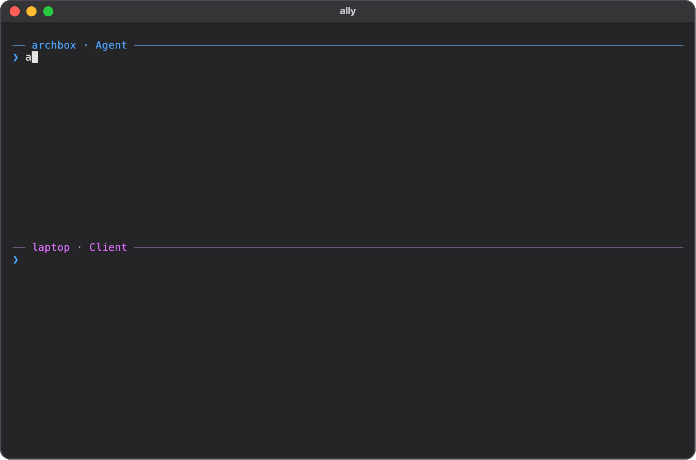

<h3 align="center">ally</h3>

<p align="center"></p>

<p align="center">
  <a href="https://github.com/ado11231/ally/actions/workflows/ci.yml"></a>
  
</p>

<p align="center">run terminal processes on your stronger computer. use your gaming PC or mini computer as a server.</p>

<p align="center"></p>

## What It Does

* **Your laptop stays light.** Builds, servers, and coding agents run on the powerful machine, with live output, colors, and Ctrl C as usual.
* **Your tools stay the same.** Keep your own editor, terminal, and browser.
* **Only code is copied.** Build files stay on the powerful machine, and work keeps running when the laptop closes.
* **Works anywhere, privately.** No account and no network setup. Linking codes work once, and everything runs as your own account.

## Setup

* The **Agent** is the powerful computer. The **Client** is the one you work on.

### 1. Install On Both Machines

Install the tools Ally uses:

| System | Command |
| --- | --- |
| Arch Linux | `sudo pacman -S --needed rsync tmux openssh` |
| Ubuntu or Debian | `sudo apt install rsync tmux curl` |
| Fedora | `sudo dnf install rsync tmux` |
| macOS | `brew install tmux`, with [Homebrew](https://brew.sh). For the menu bar app, also `xcode-select --install`. |

Then install Ally:

```sh
curl -fsSL https://raw.githubusercontent.com/ado11231/ally/master/install.sh | sh
```

* It installs `ally` to `~/.local/bin`, and prints the line to add it to PATH if needed.
* To build from source instead, with Rust: `cargo install --locked --git https://github.com/ado11231/ally ally-cli`.

### 2. Start The Agent

Turn on its ssh server first:

| System | Command |
| --- | --- |
| Arch Linux | `sudo systemctl enable --now sshd` |
| Fedora | `sudo dnf install openssh-server && sudo systemctl enable --now sshd` |
| Ubuntu or Debian | `sudo apt install openssh-server && sudo systemctl enable --now ssh` |
| macOS | System Settings, General, Sharing, Remote Login |

```sh
ally start
```

* Checks the machine and prints the fix for anything missing.
* Offers to start Ally after a restart. Say yes to keep the Agent ready.
* Prints a line such as `ally link 192.168.1.9:7433:K7QW9ZR2`. It works once, for 10 minutes.

### 3. Link The Client

```sh
ally link 192.168.1.9:7433:K7QW9ZR2
```

* Both machines need the same network or Tailscale for this step only. After that, Ally works from anywhere.
* On a Mac, it also offers the menu bar app.

### 4. Try It

In a project folder on the Client:

```sh
ally run cargo build
```

* Any command works, such as `npm run dev` or `python main.py`.
* Commands use the Agent's tools. Install what you need there, such as inside `ally attach`.

## Commands

| Command | Does |
| --- | --- |
| `ally run <command>` | Copies your changes, then runs the command on the Agent. |
| `ally attach` | Opens a terminal on the Agent that keeps running when you disconnect. |
| `ally sync --pull` | Brings edits made on the Agent back to the Client. |
| `ally health` | Shows the Agent's hardware and use. Add `--watch` to keep it live. |
| `ally ps` | Lists running jobs. `ally stop <id>` stops one. |
| `ally storage` | Lists the project copies on the Agent. `clean` frees build output, and `remove` deletes a copy. |
| `ally forward <port>` | Opens an Agent port at `localhost` here. Servers that `run` and `attach` start open by themselves. |
| `ally doctor` | Checks the whole setup, and prints the fix for each problem. |

Every command and option is in [USAGE.md](https://github.com/ado11231/ally/blob/master/docs/USAGE.md).

## Menu Bar

On a Mac, `link` offers a menu bar app showing how busy the Agent is and when a run finishes.

<p align="center"></p>
