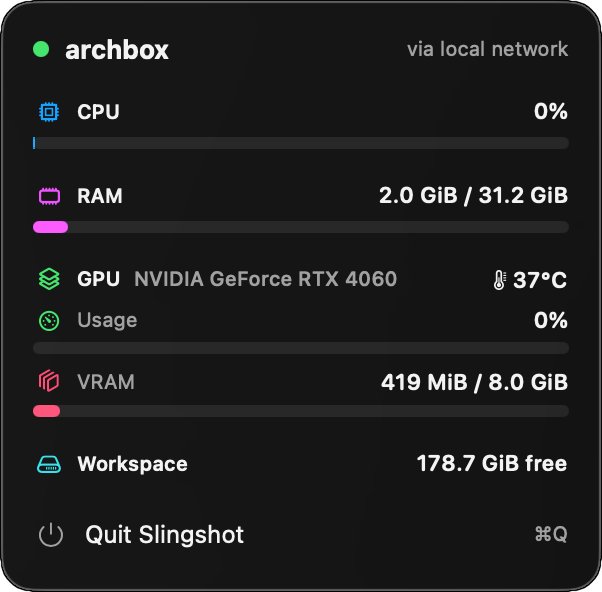

<h3 align="center">ally</h3>

<p align="center"></p>

<p align="center">
  <a href="https://github.com/ado11231/ally/actions/workflows/ci.yml"></a>
  
</p>

<p align="center">run terminal processes on your stronger computer. use your gaming PC or mini computer as a server.</p>

## What It Does

* Builds, servers, and coding agents run on the powerful machine. You keep your own editor, terminal, and browser.
* Only your code is copied. Build files stay on the powerful machine, and work keeps running when the laptop closes.
* No account and no network setup. It works from anywhere after one link.

## Setup

* The **Agent** is the powerful computer. The **Client** is the one you work on.

1. Install the tools Ally uses. The ssh server is needed on the Agent only.

| System | Tools | ssh server |
| --- | --- | --- |
| Arch Linux | `sudo pacman -S --needed rsync tmux openssh` | `sudo systemctl enable --now sshd` |
| Ubuntu or Debian | `sudo apt install rsync tmux curl` | `sudo apt install openssh-server && sudo systemctl enable --now ssh` |
| Fedora | `sudo dnf install rsync tmux` | `sudo dnf install openssh-server && sudo systemctl enable --now sshd` |
| macOS | `brew install tmux` | System Settings, General, Sharing, Remote Login |

2. Install Ally on both machines:

```sh
curl -fsSL https://raw.githubusercontent.com/ado11231/ally/master/install.sh | sh
```

* It installs `ally` to `~/.local/bin`, and prints the line to add it to PATH if needed.
* To build from source instead, with Rust: `cargo install --locked --git https://github.com/ado11231/ally ally-cli`.

3. On the Agent, run `ally start`. It prints a link line such as `ally link 192.168.1.9:7433:K7QW9ZR2`, which works once, for 10 minutes.
4. On the Client, run that line. Both machines need the same network or Tailscale for this step only.
5. In a project folder on the Client, run `ally run cargo build`, or any other command.

## Commands

| Command | Does |
| --- | --- |
| `ally run <command>` | Copies your changes, then runs the command on the Agent. |
| `ally attach` | Opens a terminal on the Agent that keeps running when you disconnect. |
| `ally sync --pull` | Brings edits made on the Agent back to the Client. |
| `ally health` | Shows the Agent's hardware and use. |
| `ally ps` | Lists running jobs. `ally stop <id>` stops one. |
| `ally storage` | Lists the project copies on the Agent, and frees their space. |
| `ally forward <port>` | Opens an Agent port at `localhost` here. |
| `ally doctor` | Checks the whole setup, and prints the fix for each problem. |

* Every command and option is in [USAGE.md](https://github.com/ado11231/ally/blob/master/docs/USAGE.md).
* On a Mac, `ally link` also offers a menu bar app that shows how busy the Agent is and when a run finishes. It needs `xcode-select --install`.

<p align="center"></p>
