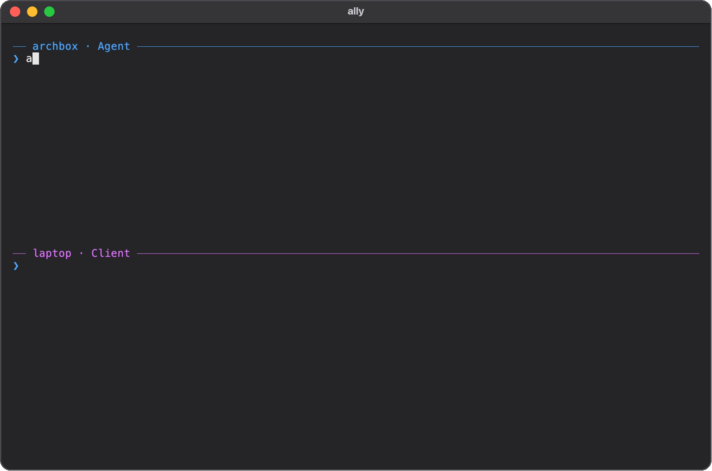
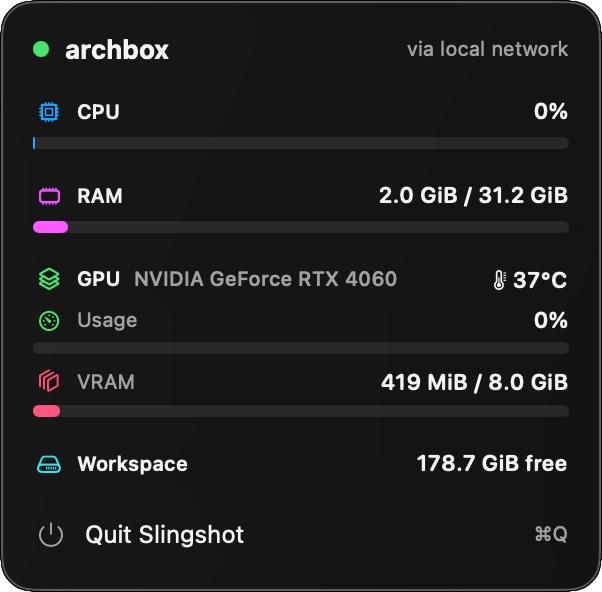

<h3 align="center">slingshot</h3>

<p align="center"></p>

<p align="center">
  <a href="https://github.com/ado11231/ss/actions/workflows/ci.yml"></a>
  <a href="https://crates.io/crates/slingshot-cli"></a>
  
</p>

<p align="center">Use the CPU, RAM, and GPU of a more powerful computer, right from your laptop. Local AI models are coming next.</p>

<p align="center"></p>

## What It Does

* **Use a stronger computer.** Builds and servers run on your powerful machine, started from your laptop.
* **Feels local.** Output, colors, and shortcuts work as usual.
* **Keep your tools.** Your editor, terminal, and browser stay the same.
* **Fast copying.** Only your code is copied. Build files stay on the powerful machine.
* **Keeps running.** Close your laptop, and your work carries on.
* **Works anywhere.** Home or away, with no account and no network setup.
* **Private.** One time linking codes, and everything runs under your own account.

## Setup

| Machine | What It Is |
| --- | --- |
| **Agent** | The powerful computer that does the work. |
| **Client** | The computer you work on, such as your laptop. |

### On The Agent

**1. Install what Slingshot needs.** Open your system and run the commands.

<details>
<summary>Arch Linux</summary>

```sh
sudo pacman -S --needed base-devel rsync tmux openssh rustup
rustup default stable
sudo systemctl enable --now sshd
```

</details>

<details>
<summary>Ubuntu or Debian</summary>

```sh
sudo apt install rsync tmux openssh-server curl build-essential
sudo systemctl enable --now ssh
curl --proto '=https' --tlsv1.2 -sSf https://sh.rustup.rs | sh
```

When asked, press Enter to install Rust, then open a new terminal.

</details>

<details>
<summary>Fedora</summary>

```sh
sudo dnf install rsync tmux openssh-server gcc
sudo systemctl enable --now sshd
curl --proto '=https' --tlsv1.2 -sSf https://sh.rustup.rs | sh
```

When asked, press Enter to install Rust, then open a new terminal.

</details>

<details>
<summary>macOS</summary>

```sh
xcode-select --install
curl --proto '=https' --tlsv1.2 -sSf https://sh.rustup.rs | sh
brew install tmux
```

A window opens to install Apple's developer tools. Finish it before going on.

When asked, press Enter to install Rust, then open a new terminal.

Install [Homebrew](https://brew.sh) first if you don't have it.

Turn on Remote Login in System Settings, General, Sharing.

</details>

<br>

**2. Install Slingshot.**

```sh
cargo install --locked --git https://github.com/ado11231/ss slingshot-cli
slingshot --version
```

If `command not found` shows, your terminal can't find Slingshot yet. Add it to your path with this line, then open a new terminal. On zsh, use `~/.zshrc` instead.

```sh
echo 'export PATH="$HOME/.cargo/bin:$PATH"' >> ~/.bashrc
```

**3. Start Slingshot.**

```sh
slingshot start
```

Checks the machine and shows how to fix anything missing.

Asks whether to start Slingshot when the computer turns on. Answer yes to keep the Agent ready after a restart.

Prints a line such as `slingshot link 192.168.1.9:7433:K7QW9ZR2` for the Client.

Each line works once and expires after 10 minutes. Press Enter for a new one.

### On The Client

**1. Install what Slingshot needs.** Open your system and run the commands.

<details>
<summary>macOS</summary>

```sh
xcode-select --install
curl --proto '=https' --tlsv1.2 -sSf https://sh.rustup.rs | sh
```

A window opens to install Apple's developer tools. Finish it before going on.

When asked, press Enter to install Rust, then open a new terminal.

</details>

<details>
<summary>Arch Linux</summary>

```sh
sudo pacman -S --needed base-devel rsync rustup
rustup default stable
```

</details>

<details>
<summary>Ubuntu or Debian</summary>

```sh
sudo apt install rsync curl build-essential
curl --proto '=https' --tlsv1.2 -sSf https://sh.rustup.rs | sh
```

When asked, press Enter to install Rust, then open a new terminal.

</details>

<details>
<summary>Fedora</summary>

```sh
sudo dnf install rsync gcc
curl --proto '=https' --tlsv1.2 -sSf https://sh.rustup.rs | sh
```

When asked, press Enter to install Rust, then open a new terminal.

</details>

<br>

**2. Install Slingshot**, the same way as on the Agent.

```sh
cargo install --locked --git https://github.com/ado11231/ss slingshot-cli
slingshot --version
```

If `command not found` shows, add Slingshot to your path the same way as on the Agent.

**3. Link to the Agent.** Run the line the Agent printed.

```sh
slingshot link 192.168.1.9:7433:K7QW9ZR2
```

Both machines need the same network or Tailscale for this step only. After that, Slingshot works from anywhere.

Offers to set up your tools on the Agent, such as Claude Code, and the menu bar app on a Mac. Asks before each one.

**4. Try it.** Open a terminal in your project folder, then run:

```sh
slingshot run cargo build
```

Any command works, such as `npm run dev` or `python main.py`.

`sling` is the short name: `sling run cargo build`.

## Commands

| Command | Does |
| --- | --- |
| `slingshot run <command>` | Copies your changes, then runs the command on the Agent. |
| `slingshot attach` | Opens a terminal on the Agent that keeps running when you disconnect. |
| `slingshot sync --pull` | Brings edits made on the Agent back to the Client. |
| `slingshot health` | Shows the Agent's hardware and use. Add `--watch` to keep it live. |
| `slingshot ps` | Lists running jobs. `slingshot stop <id>` stops one. |
| `slingshot projects` | Lists the projects on the Agent and their size. `clean` frees build output. |

Every command and option is in [USAGE.md](docs/USAGE.md).

## Menu Bar

On a Mac, `link` offers a menu bar app showing how busy the Agent is and when a run finishes.

<p align="center"></p>
