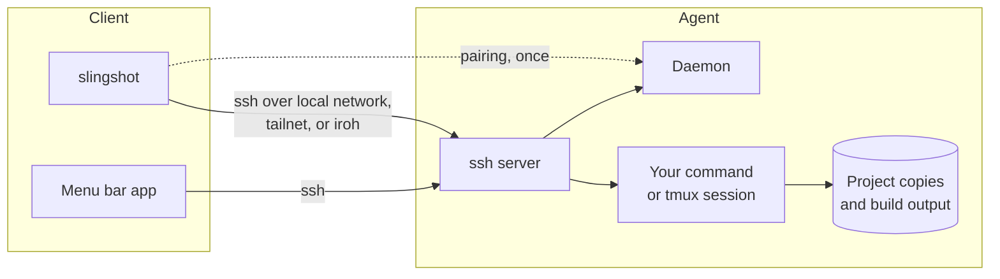
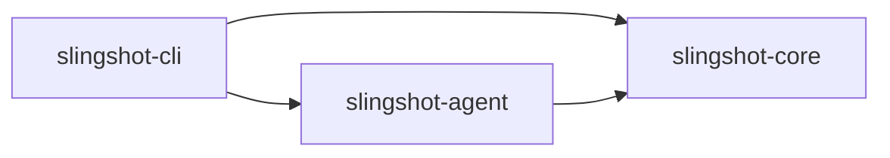
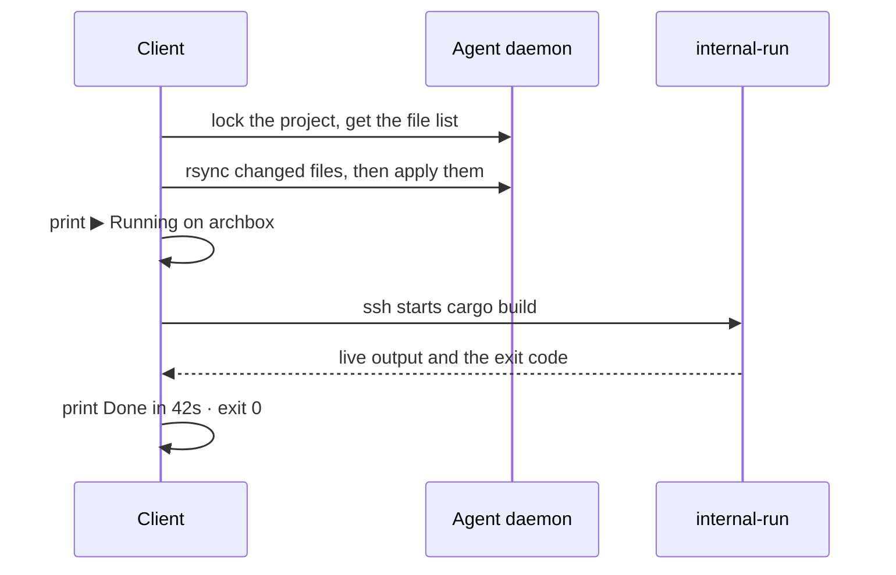
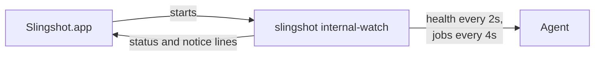

# Architecture

* How Slingshot works inside, and what every source file does.
* For contributors. Commands are in [USAGE.md](USAGE.md).

## Contents

1. [Overview](#overview)
2. [Key Terms](#key-terms)
3. [The System](#the-system)
4. [The Crates](#the-crates)
5. [How The Machines Talk](#how-the-machines-talk)
6. [How The Client Reaches The Agent](#how-the-client-reaches-the-agent)
7. [A Run From Start To Finish](#a-run-from-start-to-finish)
8. [Keeping Files In Step](#keeping-files-in-step)
9. [Build Output](#build-output)
10. [Runs And Sessions](#runs-and-sessions)
11. [The Menu Bar App](#the-menu-bar-app)
12. [Security](#security)
13. [Where Data Is Stored](#where-data-is-stored)
14. [File Reference](#file-reference)

## Overview

* Slingshot copies your project to a powerful machine, runs your commands there, and streams the results back. You keep your own editor and terminal.
* Three rules shape the design:

1. **The Client stays light.** It edits files and shows output, and never does heavy work.
2. **Slingshot wraps proven tools.** `ssh` connects, `rsync` copies, `tmux` keeps terminals running, and the `iroh` library connects across the internet.
3. **Slingshot says where work runs.** Every remote command starts with a line such as `▶ Running on archbox via tailnet`.

## Key Terms

| Term | Meaning |
| --- | --- |
| **Client** | The machine you work on. |
| **Agent** | The powerful machine that does the work. |
| **Daemon** | The background program started by `slingshot start` or the boot service. |
| **Tailnet** | A private network between your machines, made by a VPN such as Tailscale. |
| **Relay** | A public server that passes encrypted traffic when two machines cannot connect directly. |
| **Source copy** | The Agent's copy of your project, holding only source files. |
| **Baseline** | The last version of the project both machines agreed on. |
| **Build output** | Files a build creates, such as `target` or `node_modules`. |
| **Job** | One run or one session on the Agent. |

## The System



* Solid arrows are everyday traffic. All of it is `ssh`.
* The dotted arrow is pairing, done once on a shared network.

## The Crates

* One Rust workspace of three crates builds one program, `slingshot`. The command decides whether it acts as the Client or the Agent.



| Crate | Contains |
| --- | --- |
| `slingshot-core` | Rules both machines share: message formats, settings, which files are source, sync, build output rules, and output style. |
| `slingshot-agent` | The daemon: pairing, the control service, project storage, jobs, and the iroh endpoint. |
| `slingshot-cli` | Every command, the `ssh` and `rsync` calls, choosing a path, and the menu bar helper. |

* Dependencies flow one way, as drawn. A rule both machines need lives in `slingshot-core`.

## How The Machines Talk

| Traffic | How It Travels | Purpose |
| --- | --- | --- |
| **Pairing** | JSON over TCP port 7433 | Trades a one time code for access. |
| **Control** | `ssh` starts `slingshot internal-control` | Short requests: health, jobs, sync plans, sessions, environment files, tools. |
| **Work** | `ssh` starts `slingshot internal-run`, or joins `tmux` | Runs your command in a real terminal. |
| **Files** | `rsync` through `slingshot internal-rsh` | Copies changed source files either way. |

* Only pairing has its own port. Everything else is `ssh`, so it is encrypted and every caller is checked.
* Commands starting with `internal-` are hidden helpers Slingshot starts itself.

### Pairing

1. `slingshot start` prints a code such as `192.168.1.9:7433:K7QW9ZR2`: address, port, and secret.
2. `slingshot link <code>` connects. Both sides turn the secret into a shared key with SPAKE2, which never sends the secret.
3. The Client sends its ssh key and iroh identity, with a proof made from the shared key.
4. The Agent checks the proof, then installs the key under the Client's name, such as `slingshot:MacBook-Pro-3f9c2a`: the hostname plus the start of its iroh key.
5. The Agent replies with its ssh identity, addresses, iroh identity, and hardware, with its own proof.
6. The Client checks that proof, so a fake Agent is caught, and saves the details.

* A code works once, expires after 10 minutes, and is burned after 3 wrong tries. A guess only counts when sent to the Agent.
* An Agent with linked Clients prints a code only when Enter is pressed.
* The boot service runs `slingshot internal-daemon`, which has no pairing port. A `slingshot start` beside it pairs in its own process, so the code never reaches the daemon. Pairing only writes `authorized_keys` and the iroh Client list, which the daemon reads fresh.
* `slingshot unlink` reverses pairing: removes the key, deletes the Client's environment files, and forgets the Agent.

### Control

1. The Client runs `ssh <agent> slingshot internal-control`.
2. The helper opens the daemon's private socket, usable only by the Agent's account.
3. Requests and replies are JSON, each with a version, a size limit, and a time limit.

* Message types live in `slingshot-core/src/control.rs`. Changing their shape raises `control::VERSION`, so mismatched versions refuse to talk.

### Work And Files

* Commands, sessions, and copies all use the real `ssh` and `rsync`.
* Slingshot builds every `ssh` call itself, with its own key and known hosts list, so you never edit `~/.ssh/config`.

## How The Client Reaches The Agent

* Before connecting, the Client tries every saved address at once and uses the highest one that answers:

| Order | Path | Works When |
| --- | --- | --- |
| 1 | Local network | Both machines share a network. |
| 2 | Tailnet | Both machines share a VPN such as Tailscale. |
| 3 | iroh | Both machines have internet, anywhere. |

* iroh gets past home routers by having both machines reach out at once. When that fails, traffic goes through a relay.
* Over iroh, `ssh` connects through `slingshot internal-tunnel`, and the Agent passes it only to its own ssh server. A relay sees only encrypted `ssh`.
* Over iroh, calls share one ssh connection, so repeated calls are fast.

## A Run From Start To Finish



* A failing command is not a Slingshot error. Its exit code is reported as is.

## Keeping Files In Step

* `slingshot-core/src/source.rs` decides what counts as source. It follows `.gitignore`, and always leaves out `.git`, build output, and environment files. Left out files are never copied, pulled, previewed, or backed up.

1. Each machine lists its source files with a fingerprint of each.
2. Each list is compared with the baseline.
3. A file changed only on the sending side is sent. A file changed only on the other side is kept.
4. A file changed on both is a **conflict**. The sync stops and nothing is overwritten. `--overwrite` settles listed conflicts only after the owner agrees, and the Agent accepts only the files the Client names.
5. `rsync` copies changed files into a staging folder.
6. The receiving side checks every staged file, then applies them all at once, or restores the previous state if anything fails.

* `--pull` runs the same steps the other way. `--check` shows the plan only.
* `slingshot env add` stores environment files outside the source copy. Their contents never appear in arguments.

## Build Output

* Build output is never copied. It is large and always changing. This is the most important performance rule.

| Project | Found By | What Moves | How |
| --- | --- | --- | --- |
| Rust | `Cargo.toml` | `target` | `CARGO_TARGET_DIR` points to Agent storage. |
| Node | `package.json` | `node_modules` | A link points to Agent storage. |
| Python | `pyproject.toml` or `requirements.txt` | The pip cache | `PIP_CACHE_DIR` points to Agent storage. |

* A Python `.venv` stays in the source copy, because `python3 -m venv` refuses a link. The scan skips it.
* Detection lives in `slingshot-core/src/stack.rs`, and the rules in `slingshot-core/src/artifacts.rs`.

## Runs And Sessions

| | Run | Session |
| --- | --- | --- |
| Started by | `slingshot run` | `slingshot attach` |
| Lasts | As long as the connection. A drop stops it and records it as interrupted. | Until ended. It is a `tmux` session. |
| Works in | The project, through `~/Slingshot/<project>` | The project through the same link, or the home folder outside one |
| Blocks syncs | Yes, it owns the project copy while it works | No |

* The `~/Slingshot/<project>` link keeps prompts short, and lets tools such as Docker Compose name things after the project.
* Each project has one session, and the home folder has one.
* Sessions use Slingshot's own `tmux` server and settings, so a personal `tmux` setup is untouched. They start the account's login shell from the user database, with a full color terminal, a `UTF-8` locale, mouse scrolling, and a quiet bar.
* `slingshot stop <id>` asks a job to finish, then forces it after five seconds. The Agent checks a process's ID and start time first, so it never stops a program that reused an old ID.

## The Menu Bar App

* A SwiftUI app in `crates/slingshot-cli/menubar/`. It only displays and notifies. Every decision is made in Rust.



* `internal-watch` prints one JSON line at a time: a **status** line with each value and its level, or a **notice** line with a notification already worded.
* Thresholds, rules, and wording live in `crates/slingshot-cli/src/watch/`. The line format has its own version, `watch::event::VERSION`, and the app refuses versions it does not know.
* Try again writes `retry` to the helper, which reconnects at once.
* The helper exits when its program file is replaced, such as by `cargo install`, and the app starts the new one. It checks every 5 seconds.
* The app's source, logo, and icon are built into `slingshot`. `slingshot menubar` writes them out, builds with Swift, signs for this machine, and installs to `~/Applications`. It rebuilds only when the source fingerprint changed.
* `slingshot menubar` also saves where `slingshot` is, since apps started at login cannot find it, and restarts a running app.
* The app is always a login item. `--remove` starts it once with `--remove` to leave login items, since only the app can, then deletes it.

## Security

* Pairing codes never cross the network. They work once, expire, and are burned after 3 wrong tries. Both sides prove they know the code.
* The daemon listens only on the machine itself and the local network.
* Installed ssh keys are named so `slingshot unlink` can remove them.
* Arguments sent to the Agent are quoted one by one, never joined into one shell command.
* Control messages carry a version, a size limit, and a time limit.
* The Agent's user account is the security boundary.
* The Agent accepts iroh connections only from paired Clients, and passes them only to its own ssh server.
* Environment file contents never appear in arguments.

## Where Data Is Stored

* Folders come from each system's standard places, through the `directories` crate. No path is fixed in code.

| Client | Where |
| --- | --- |
| Saved Agents | `config.toml` in Slingshot's config folder |
| Agent ssh identities | `known_hosts` in Slingshot's config folder |
| Slingshot's ssh key | `~/.ssh`, under a Slingshot name |
| iroh identity | `client/` in Slingshot's data folder |

* On the Agent, inside Slingshot's data folder:

```
jobs/                  one record per run or session
projects/<project id>/
├── source/            the source copy
├── artifacts/         build output, such as target, node_modules, and the pip cache
├── environment/       files added with slingshot env
└── state/             the baseline, staging, and backups
```

## File Reference

* Every source file, its purpose, which Slingshot files it uses, and which use it. Outside libraries are not listed.

```
slingshot/
├── .github/
│   ├── workflows/ci.yml       the checks on every push to master and every pull request
│   ├── dependabot.yml         a weekly pull request for new crate and Action versions
│   ├── ISSUE_TEMPLATE/        the forms for a problem or an idea
│   └── pull_request_template.md   the checklist every pull request starts with
├── Cargo.toml                 the workspace and shared dependency versions
├── crates/
│   ├── slingshot-core/        shared rules and types
│   ├── slingshot-agent/       the Agent daemon
│   └── slingshot-cli/         the slingshot program
│       └── menubar/           the macOS menu bar app, shipped inside the crate
├── LICENSE-MIT, LICENSE-APACHE
└── docs/                      architecture, usage, troubleshooting, roadmap, and media
```

### `slingshot-core`

| File | Purpose | Uses | Used By |
| --- | --- | --- | --- |
| `lib.rs` | Lists the modules. | none | the other crates |
| `protocol.rs` | Pairing messages and the SPAKE2 handshake, hardware details, and health values. | none | `config`, `control`, `telemetry`, Agent `lib`, several Client commands |
| `control.rs` | Versioned control messages, job records, and message reading and writing. | `protocol`, `source`, `tools` | Agent `service`, `jobs`, `projects`, `runner`; Client `client`, `transfer`, most commands |
| `config.rs` | The Client's saved Agents: loading, saving, and choosing one. | `network`, `protocol` | `keys` and nearly every Client file |
| `network.rs` | Tells local, tailnet, and other addresses apart. | none | `config`, Agent `lib`, Client `route` |
| `tunnel.rs` | What both machines share for iroh: the connection name and a saved identity. | `storage`, `source` | Agent `lib`, `clients`, `tunnel`; Client `route`, `tunnel`, `link` |
| `keys.rs` | Names the installed ssh key and reads this machine's ssh identity. | `config`, `storage` | Agent `lib`; Client `keys`, `link`, `unlink`, `transfer` |
| `storage.rs` | Private folders, IDs, safe file writes, and file locks. | none | `source`, `sync`, `keys`, `tunnel`, and many files in both other crates |
| `source.rs` | Decides which files are source, and fingerprints them. | `storage` | `control`, `sync`, `tunnel`, Agent `projects`, Client `transfer`, `env`, `menubar` |
| `sync.rs` | Three way sync: planning, conflicts, staging, and safe apply with rollback. | `source`, `storage` | Agent `projects`, Client `transfer` |
| `stack.rs` | Recognizes Rust, Node, and Python projects. | none | `artifacts`, `tools` |
| `artifacts.rs` | Where each kind of project keeps its build output on the Agent. | `stack` | Agent `projects`, Client `run` |
| `telemetry.rs` | Reads hardware details and live use with `sysinfo` and `nvidia-smi`. | `presentation`, `protocol` | `preflight`, `tools`, Agent `lib`, Client `health`, `transfer`, `watch` |
| `preflight.rs` | Setup checks that print the fix, and the package manager's install command. | `presentation`, `telemetry` | `tools`, Agent `lib`, `jobs`, `service`; Client `link`, `transfer` |
| `tools.rs` | The tools Slingshot can set up on the Agent, how to find them, and their install commands. | `preflight`, `stack`, `telemetry` | `control`, Agent `service`, Client `tools` |
| `presentation.rs` | The shared output style: symbols, colors, rows, and sizes. | none | `step`, `preflight`, `telemetry`, every command |
| `step.rs` | A spinner for slow work, then a finished line with the time taken. | `presentation` | Agent `lib`; Client `client`, `transfer`, `run`, `link`, `ps`, `unlink` |

### `slingshot-agent`

| File | Purpose | Uses | Used By |
| --- | --- | --- | --- |
| `lib.rs` | `slingshot start`: setup checks, the start screen, pairing, and starting the other parts. `slingshot internal-daemon`: the same without pairing, for the boot service. | `awake`, `clients`, `service`, `tunnel` | Client `lib` |
| `service.rs` | The private control socket, the `internal-control` helper that reaches it, and the tools probe run in the login shell. | `clients`, `jobs`, `projects` | `lib`, `runner`, Client `lib` |
| `projects.rs` | Project storage: source copies, sync locks, build output, and environment files. Lists, cleans, and removes copies. | `jobs` | `service`, `jobs`, `runner`, `uninstall` |
| `jobs.rs` | Job records, `tmux` sessions, and safe stopping. | `projects` | `service`, `projects`, `runner` |
| `runner.rs` | `slingshot internal-run`: runs one command in the project copy with a real terminal. | `jobs`, `projects`, `service` | Client `lib` |
| `clients.rs` | The Clients allowed over iroh, and their names for the start screen. | none | `lib`, `service`, `tunnel` |
| `tunnel.rs` | The iroh endpoint, which passes paired Clients to the local ssh server. | `clients` | `lib` |
| `uninstall.rs` | What `slingshot uninstall` removes on an Agent: the boot service, running work, Client access, the `~/Slingshot` links, and the data. | `boot`, `jobs`, `projects`, `service` | Client `uninstall` |
| `awake.rs` | Keeps the Agent awake while the daemon runs, and checks whether sleep is off. | none | `lib` |
| `boot.rs` | Starting by itself: writes and removes the systemd user service or launchd agent. | none | `lib` |

* `projects.rs` and `jobs.rs` use each other: a sync must know if a job runs, and a job must know where its project lives.

### `slingshot-cli`

| File | Purpose | Uses | Used By |
| --- | --- | --- | --- |
| `lib.rs` | Reads the command line with `clap`, calls the command, and defines the hidden `internal-` helpers. | every command; Agent `lib`, `runner`, `service` | `main`, `bin/sling` |
| `main.rs` | The `slingshot` program. Calls `lib`. | `lib` | none, it is the entry point |
| `bin/sling.rs` | The `sling` program, the same under a shorter name. | `lib` | none, it is an entry point |
| `build.rs` | Puts the build's commit into `--version`, using `git` when present. | `git` | `lib` |
| `client.rs` | The pairing connection, and the `Control` connection over `ssh`. | `route`, `ssh`, `tunnel` | `transfer`, `watch`, most commands |
| `route.rs` | Chooses the path: local network, tailnet, or iroh. Prints the `▶` location line. | none | `client`, `ssh`, `transfer`, `watch`, `run`, `attach`, `tools` |
| `ssh.rs` | Builds every `ssh` call, with safe quoting and a shared connection. | `route`, `tunnel` | `client`, `run`, `attach`, `unlink` |
| `tunnel.rs` | `slingshot internal-tunnel`: the Client's end of an iroh connection. | `project` | `client`, `ssh` |
| `transfer.rs` | Performs a sync: lists files, plans, calls `rsync`, and reports. | `client`, `project`, `route` | `run`, `attach`, `sync` |
| `project.rs` | Finds the current project and its ID on each Agent. | none | `transfer`, `tunnel`, most commands |
| `keys.rs` | Creates Slingshot's own ssh key. | none | `link` |
| `live.rs` | Full screen views that refresh until Q or Ctrl C. | none | `health` |
| `watch/mod.rs` | `slingshot internal-watch`: polls the Agent and prints lines for the menu bar app. | `client`, `route`, `watch/event`, `watch/state` | `lib` |
| `watch/event.rs` | The line format, value levels, and plain explanations of failures. | `commands/health` | `watch/mod`, `watch/state` |
| `watch/state.rs` | Decides when a notification is due, and words it. | `commands/health`, `watch/event` | `watch/mod` |

### Commands

* One file per command in `crates/slingshot-cli/src/commands/`, each called by `lib.rs`. `mod.rs` lists them.

| File | Command | Uses |
| --- | --- | --- |
| `link.rs` | `slingshot link` | `client`, `keys`, `project`, `menubar`, `tools` |
| `tools.rs` | `slingshot tools`, and the tools step of `link` | `client`, `project`, `route`, `ssh`, `run` |
| `uninstall.rs` | `slingshot uninstall`: the Client's settings, key, app, and links, plus the Agent's part on an Agent | `keys`, `menubar`, `unlink`, Agent `uninstall` |
| `unlink.rs` | `slingshot unlink` | `client`, `project`, `ssh` |
| `run.rs` | `slingshot run` | `client`, `project`, `route`, `ssh`, `transfer` |
| `attach.rs` | `slingshot attach` | `client`, `project`, `route`, `ssh`, `transfer`, `run` |
| `sync.rs` | `slingshot sync` | `project`, `transfer` |
| `env.rs` | `slingshot env` | `client`, `project` |
| `projects.rs` | `slingshot projects`, `clean`, and `remove` | `client`, `project`, `ps` |
| `ps.rs` | `slingshot ps` and `slingshot stop` | `client` |
| `health.rs` | `slingshot health`, jobs in `--watch`, and the thresholds `watch` shares | `client`, `live`, `ps` |
| `menubar.rs` | `slingshot menubar`, and the offer at the end of `link` | `project`, `ssh`, `tools` |

### Tests

* Unit tests sit at the bottom of the file they test.
* `crates/slingshot-cli/tests/output.rs` runs the real program to check help text, colors, and errors.

### `crates/slingshot-cli/menubar`

| File | Purpose |
| --- | --- |
| `Package.swift` | The Swift package. No outside dependencies. |
| `Info.plist` | The app's identity. Hides the Dock icon. |
| `AppIcon.icns` | The icon on notifications and in Finder, made from the logo without smoothing. |
| `Logo.png` | The menu bar logo, drawn in the menu bar's color. A copy of `docs/media/slingshot.png` that ships with the crate. |
| `Sources/App.swift` | The starting point and menu bar icon. |
| `Sources/Watcher.swift` | Starts `internal-watch`, reads its lines, restarts it if it stops, and sends `retry`. |
| `Sources/Model.swift` | Reads the JSON lines. Must match `watch/event.rs`. |
| `Sources/PopoverView.swift` | The panel: the four sections, the offline screen, and the bottom rows. |
| `Sources/Bars.swift` | The usage bar every section shares. |
| `Sources/Notifier.swift` | Posts notifications. |
| `Sources/LoginItem.swift` | Starts the app at login, and removes that for `--remove`. |

* `Model.swift` and `watch/event.rs` describe one format from both sides. Change them together, and raise `watch::event::VERSION` when a field changes meaning or is removed.
